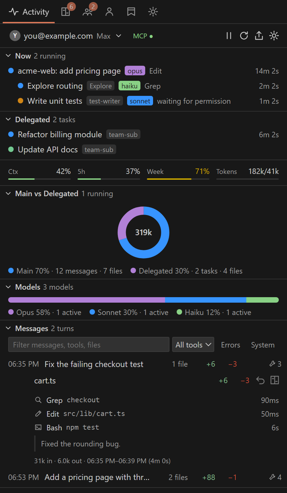
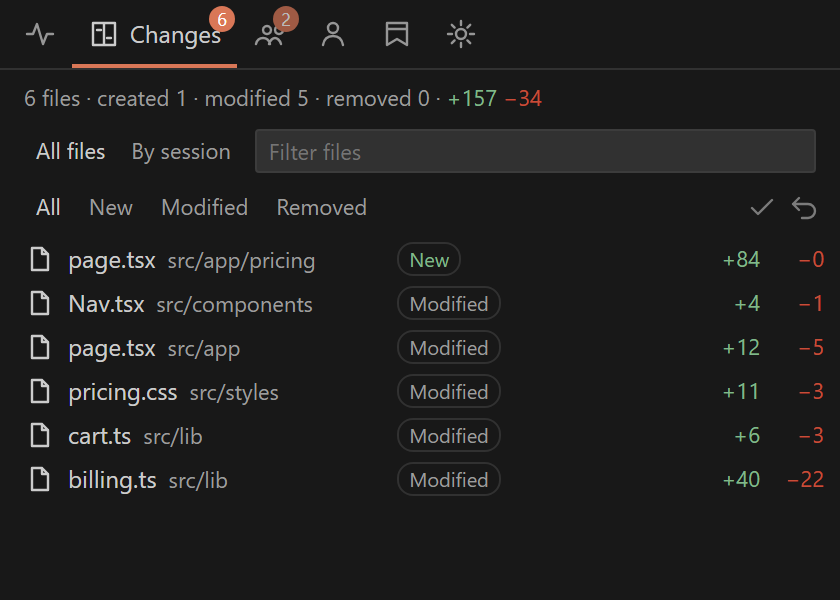
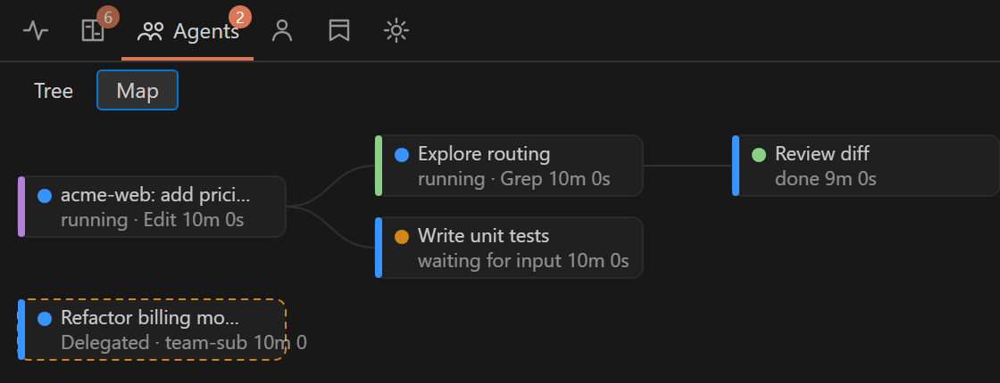
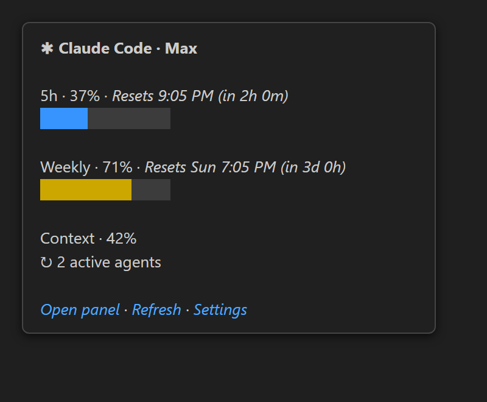

# Claude Code Control Center

A VS Code sidebar, status bar item and chat-box mod that monitor your [Claude Code](https://code.claude.com) sessions, agents, terminals, file changes and usage limits, and let you delegate tasks to additional Claude accounts.

> **Unofficial.** This project is an independent companion to Anthropic's `anthropic.claude-code` extension. It is **not affiliated with, endorsed by, or sponsored by Anthropic**. It never patches the official extension. "Claude" and "Claude Code" are trademarks of Anthropic.

<!-- TODO: add screenshots in docs/images/ -->
| | |
|---|---|
|  |  |
|  |  |
|  |  |

## Features

One sidebar webview ("Control Center") with six tabs: Activity, Changes, Agents, Accounts, Checkpoints, Settings.

- **Activity**: "Now" strip of running sessions, subagents and delegated tasks with state chips (running, waiting for input, waiting for permission, idle, done, failed), current tool and elapsed time; metric row (context, 5h, weekly, tokens); per-model usage (bar or donut); a messages timeline of the selected session read from the local transcript (prompts, replies, tool calls, nested subagents, files changed per message, "Revert to before this message").
- **Changes**: files changed by Claude (Edit/Write/NotebookEdit) per session, with diff, Keep and Undo. Undo restores the pre-edit text from Claude Code's own file history (confirmation required).
- **Agents**: tree and map of sessions and subagents with state, type, model, tasks, tools and tokens.
- **Accounts and delegation**: several Claude logins (one `CLAUDE_CONFIG_DIR` each), per-account 5h/weekly usage, and delegation of standalone tasks to a sub-account from the UI, the editor context menu, or an MCP tool the main agent can call.
- **Checkpoints**: manual or automatic (per prompt) workspace snapshots with restore; size and exclude limits.
- **Settings**: the extension's settings in one tab.
- **Status bar card**: Claude item showing limits and running agents, with a hover card.
- **Chat-box mod**: a band above the Claude Code prompt listing changed files, subagents, context %, 5h and weekly usage (see [docs/MOD.md](docs/MOD.md)).
- **Terminal mirror**: each session gets a read-only terminal showing the Bash/PowerShell commands Claude ran and their output. Closing a mirror never stops Claude or a command.
- **Attention alerts**: notifications when Claude needs permission or input, or a delegated task finishes.
- **Session export**: "Export Session as Markdown".

## Requirements

- VS Code 1.95 or newer.
- [Claude Code CLI](https://code.claude.com/docs) installed and logged in (the extension runs `claude -p /usage` for limits).
- Node.js is needed by Claude Code hooks (plain Node scripts) and to build from source.

## Install

From a VSIX:

```
code --install-extension claude-code-control-center-0.1.0.vsix --force
```

From source:

```
npm ci
npm run package        # builds claude-code-control-center-<version>.vsix
code --install-extension claude-code-control-center-0.1.0.vsix --force
```

Reload the window afterwards.

## Setup

1. **Hooks** (session and agent detection): run "Claude Control Center: Install Claude Code Hooks". It previews the merged `hooks` block, asks for confirmation, backs up `~/.claude/settings.json` and writes atomically. Restart running Claude sessions.
2. **Status line** (optional, rate limits): "Install Status Line Capture (rate limits)". Wraps your existing `statusLine` command and restores it on uninstall.
3. **MCP server** (optional, delegation from the main agent): "Install Delegation MCP Server (ccc-accounts)" in the Accounts view menu. Runs `claude mcp add --scope user` after confirmation.
4. **Mod plugin** (optional): from a clone of this repo,
   ```
   claude plugin marketplace add "<path-to-clone>"
   claude plugin install control-center@ccc-local
   ```
   The plugin is read live from `mod/`; reload plugins or start a new session. Validate with `claude plugin validate ./mod`.

## Settings

| Setting | Type | Default | Description |
|---|---|---|---|
| `ccc.refreshIntervalSeconds` | number | `5` | Fallback poll interval (seconds) used in addition to file watching. |
| `ccc.staleAfterSeconds` | number | `120` | Agents with no events for this long are marked stale and never shown as live. |
| `ccc.historyLimit` | number | `500` | Maximum number of events kept in memory. |
| `ccc.recentAgentsLimit` | number | `20` | Number of recently completed/failed agents to show. |
| `ccc.terminate.requireConfirmation` | boolean | `true` | Ask for modal confirmation before closing terminals. |
| `ccc.collectPromptText` | boolean | `false` | Let the hook script record truncated prompt text. Takes effect when hooks are (re)installed. |
| `ccc.processCorrelation.enabled` | boolean | `true` | Look up parent processes to confirm which terminals run Claude Code. |
| `ccc.mirror.enabled` | boolean | `true` | Mirror Claude Code Bash/PowerShell tool calls into a read-only VS Code terminal per session. |
| `ccc.mirror.showOutput` | boolean | `true` | Let the hook record command output (stdout/stderr) so the mirror can show it. When off, the hook omits output from ~/.claude-control-center/events. |
| `ccc.mirror.maxOutputKB` | number | `64` | Maximum command output (KB) the hook records per call. |
| `ccc.mirror.focus` | never | onCreate | `"never"` | Reveal the mirror terminal (without taking keyboard focus) when it is created. |
| `ccc.views.terminals` | boolean | `false` | Show the Terminals tree in the sidebar. Claude command mirrors always live in the VS Code terminal panel. |
| `ccc.chatBox.enabled` | boolean | `true` | Show Claude's file changes inside the Claude Code chat box (written to ~/.claude-control-center/config.json as chatBox for the mod). |
| `ccc.timeline.enabled` | boolean | `true` | Show the Messages timeline in the Activity view. |
| `ccc.models.chart` | bar | donut | `"bar"` | Chart style for the Models section: one stacked bar or a donut. |
| `ccc.models.enabled` | boolean | `true` | Show the Models section (tokens and agents per model) in the Activity view. |
| `ccc.alerts.enabled` | boolean | `true` | Notify when Claude needs you (permission, waiting for input) or a delegated task finishes. |
| `ccc.alerts.permission` | boolean | `true` | Alert on permission prompts. |
| `ccc.alerts.input` | boolean | `true` | Alert when Claude is waiting for your input. |
| `ccc.alerts.tasks` | boolean | `true` | Alert when a delegated task finishes or fails. |
| `ccc.alerts.whenFocused` | boolean | `false` | Also show alerts while the VS Code window is focused. |
| `ccc.statusBar.enabled` | boolean | `true` | Show the Claude Code item (limits, running agents) in the status bar. |
| `ccc.checkpoints.autoOnPrompt` | boolean | `false` | Create a checkpoint on each prompt (debounced 30s). |
| `ccc.checkpoints.keep` | number | `50` | Checkpoints to keep; oldest automatic ones are pruned. |
| `ccc.checkpoints.maxFileKB` | number | `2048` | Files larger than this are skipped. |
| `ccc.checkpoints.maxTotalMB` | number | `200` | A checkpoint is refused above this workspace size. |
| `ccc.checkpoints.exclude` | array | `["node_modules",".git","dist","out",".vscode-test","*.vsix","*.zip","*.exe","*.dll","*.png","*.jpg","*.jpeg","*.gif","*.mp4","*.mov","*.pdf","*.7z","*.tar","*.gz"]` | Globs excluded from checkpoints (top-level .gitignore is also honored). |
| `ccc.timeline.showText` | boolean | `true` | Show prompt and reply text in the Activity timeline (read locally from the transcript, never logged or sent). Off shows tools and metadata only. |
| `ccc.changes.lookbackHours` | number | `24` | Claude Changes shows sessions (including ended ones) with activity in the last N hours. |
| `ccc.limits.pollMinutes` | number | `5` | How often to read 5h/weekly limits by running `claude -p /usage` (subscription plans). 0 disables. |
| `ccc.accounts.enabled` | boolean | `true` | Enable multiple Claude accounts (CLAUDE_CONFIG_DIR per account) and task delegation. |
| `ccc.accounts.pollMinutes` | number | `10` | How often to check login + 5h/weekly usage of each account (`claude -p /usage`, staggered). 0 disables. |
| `ccc.delegate.defaultPreset` | readonly | edit | bash | `"readonly"` | Default permission preset for delegated tasks. |
| `ccc.delegate.defaultModel` | default | haiku | sonnet | opus | `"default"` | Default model for delegated tasks. |
| `ccc.delegate.enabled` | boolean | `true` | Allow delegating tasks to sub-accounts (UI buttons and the MCP delegate_task tool). |
| `ccc.delegate.routing.heavy` | string | `"auto"` | Account for heavy delegated work: an account id, "auto" (lowest 5h usage) or "main". |
| `ccc.delegate.routing.light` | string | `"auto"` | Account for light delegated work: an account id, "auto" or "main". |
| `ccc.delegate.routing.heavyModel` | default | haiku | sonnet | opus | `"opus"` | Default model for heavy delegated work (MCP delegate_task weight=heavy). |
| `ccc.delegate.routing.lightModel` | default | haiku | sonnet | opus | `"haiku"` | Default model for light delegated work (MCP delegate_task weight=light). |
| `ccc.delegate.maxConcurrent` | number | `2` | Maximum delegated tasks running at once. |
| `ccc.limits.claudePath` | string | `"claude"` | Claude Code CLI used for `/usage`. Plain path only; shell metacharacters are rejected. |
| `ccc.delegate.allowRunFromMcp` | boolean | `false` | Allow the MCP tool delegate_task to use preset 'run' (Bash). Off by default. |
| `ccc.delegate.allowMainFromMcp` | boolean | `false` | Allow the MCP tool delegate_task to target the main account. Off by default (sub-accounts only). |

## Commands

Command palette entries (category "Claude Control Center"); other commands appear only in context menus.

| Command | Title |
|---|---|
| `ccc.checkpoint.create` | Create Checkpoint |
| `ccc.checkpoint.restore` | Restore Checkpoint |
| `ccc.exportSession` | Export Session as Markdown |
| `ccc.refresh` | Refresh |
| `ccc.pauseMonitoring` | Pause Monitoring |
| `ccc.resumeMonitoring` | Resume Monitoring |
| `ccc.installHooks` | Install Claude Code Hooks |
| `ccc.newTerminal` | New Terminal |
| `ccc.showEventHistory` | Show Event History |
| `ccc.filter` | Filter Agents |
| `ccc.installStatusLine` | Install Status Line Capture (rate limits) |
| `ccc.uninstallStatusLine` | Uninstall Status Line Capture |
| `ccc.mirror.replaySession` | Replay Session Commands in Mirror Terminal |
| `ccc.refreshLimits` | Refresh Account Limits |
| `ccc.delegateTask` | Delegate to Claude account… |
| `ccc.accounts.add` | Add Sub-Account |
| `ccc.accounts.login` | Log In Account |
| `ccc.accounts.rename` | Rename Account |
| `ccc.accounts.remove` | Remove Account |
| `ccc.accounts.toggle` | Enable/Disable Account |
| `ccc.accounts.setMain` | Set as Main Account |
| `ccc.accounts.refresh` | Refresh Accounts |
| `ccc.task.focus` | Focus Task Terminal |
| `ccc.task.openResult` | Open Task Result |
| `ccc.task.cancel` | Cancel Task |
| `ccc.task.rerun` | Re-run Task |
| `ccc.accounts.logout` | Log Out Account |
| `ccc.accounts.edit` | Edit Account… |
| `ccc.accounts.switchDefault` | Switch Default Delegation Account |
| `ccc.accounts.openClaude` | Open Claude as Account |
| `ccc.installMcp` | Install Delegation MCP Server (ccc-accounts) |
| `ccc.uninstallMcp` | Uninstall Delegation MCP Server |

## Privacy and security

- **Local only, no telemetry.** Nothing is sent to any server by this extension. The only network-capable things it runs are `claude` CLI calls you could run yourself (`claude -p /usage`, delegated tasks).
- **Reads**: `~/.claude-control-center/` (events, status line captures, config, accounts), transcripts under `~/.claude/projects`, file-history backups under `~/.claude/file-history` (validated names, size caps), `~/.claude/sessions/<pid>.json`. It never reads credential files, `~/.claude/sessions/*.key`, or `ide/*.lock` tokens.
- **Writes**: `~/.claude-control-center/**`; `~/.claude/settings.json` only through the install commands (preview, modal confirmation, backup, atomic write); workspace files only on Undo, Restore Checkpoint or Revert (confirmation; a second one outside the workspace).
- **Recorded data**: for Bash/PowerShell the hook stores the command (up to 4 KB) and, if `ccc.mirror.showOutput` is on, output up to `ccc.mirror.maxOutputKB` in `~/.claude-control-center/events/<sessionId>.jsonl`. Prompt text is recorded only if `ccc.collectPromptText` is on. Delete the folder to remove it.
- Transcripts, hook payloads and webview messages are treated as untrusted: validated, size-bounded, escaped, strict CSP with nonce. No shell interpolation; prompts go through stdin or files.
- Report vulnerabilities per [SECURITY.md](SECURITY.md).

## Limitations

- Changes made by Bash commands are not tracked (no file-history entry).
- 5h/weekly limits come only from `claude -p /usage` or the status line; API-key plans and sessions with no status line may show "Unavailable".
- The mod band caption is fixed text inside Claude Code's UI; the mods API has no hover, diff or editor-open calls, so the band cannot open diffs.
- The `AbovePrompt` slot is documented for terminal/desktop; in the VS Code panel it relies on current Claude Code behaviour, and `/ccc-changes pane` is the fallback.
- The official chat panel always uses the main `~/.claude` login; sub-accounts are reached via delegation or "Open Claude as Account".
- Terminal correlation does not work across remote, WSL or dev-container process trees.
- Only commands run after the extension activated appear in a mirror (use Replay for recorded ones).
- Windows is the primary tested platform.

## Troubleshooting

- No sessions: install hooks, then restart Claude Code. Check Output, "Claude Control Center".
- Changes empty: the transcript is tracked after the first hook event; Keep/Undo hide entries until the file is edited again.
- Limits "Unavailable": hover the tile for the reason; install status line capture and use the terminal CLI once, or set `ccc.limits.claudePath`.
- Diff says no baseline: the backup was pruned or the change predates tracking.
- Mod not showing: `claude plugin list`, then `/reload-plugins`; try `/ccc-changes pane`.

## FAQ

**Does it change Claude Code's behaviour?** No. Hooks only observe; it never patches the official extension.

**Does it cost tokens?** Only delegated tasks and `/usage` polling (set the poll settings to 0 to disable).

**Can I use it without hooks?** Only partially; session and agent detection need them.

**How do I remove it?** Uninstall hooks/status line/MCP via the commands, uninstall the extension, delete `~/.claude-control-center`.

## Contributing

See [CONTRIBUTING.md](CONTRIBUTING.md), [docs/ARCHITECTURE.md](docs/ARCHITECTURE.md) and [CODE_OF_CONDUCT.md](CODE_OF_CONDUCT.md).

## License

[MIT](LICENSE)

## Credits

Created by **Raheel Ahmad** · Powered by [Artflow Studio](https://artflow.pk)
