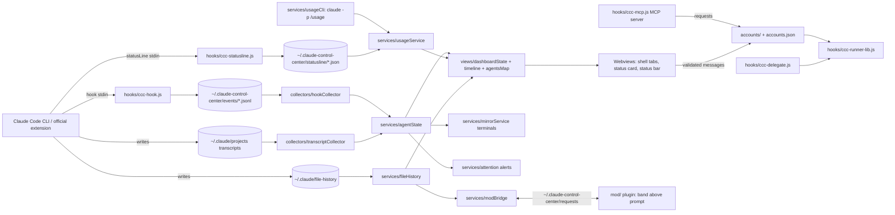

# Architecture

Claude Code Control Center observes Claude Code from the outside: hooks write events to disk, collectors tail them and the transcripts, services build state, webviews render it. Nothing is patched.

## Key modules

| Module | Role |
|---|---|
| `src/extension.ts` | Activation and wiring only |
| `src/collectors/hookCollector.ts` | Incremental, bounded tailing of hook event files |
| `src/collectors/transcriptCollector.ts` | Incremental transcript reading (turns, tokens, models) |
| `src/services/agentState.ts` | Vscode-free agent/session state machine; staleness |
| `src/services/agentService.ts` | Connects collectors, state and views |
| `src/services/usageCli.ts`, `usageService.ts` | `claude -p /usage` parsing and polling; status line limits |
| `src/services/fileHistory.ts` | Validated reads of `~/.claude/file-history` for diff, Keep, Undo |
| `src/services/mirrorService.ts`, `mirrorFormat.ts` | Read-only per-session command mirror terminals |
| `src/services/terminalService.ts`, `src/adapters/processAdapter.ts` | Terminal to session correlation |
| `src/services/hookSettings.ts` | Preview, backup and atomic edit of `~/.claude/settings.json` |
| `src/services/attention.ts` | Permission/input/task alerts |
| `src/services/modBridge.ts` | Requests dir watcher for the mod (e.g. Undo/Keep) |
| `src/views/shellProvider.ts`, `shellTabs.ts` | Single sidebar webview and tab routing |
| `src/views/dashboardProvider.ts`, `dashboardState.ts` | Activity, Changes, Accounts, Settings tab state and messages |
| `src/views/timeline.ts`, `agentsMap.ts`, `sessionExport.ts`, `statusCard.ts` | Pure builders |
| `src/accounts/` | Accounts (`CLAUDE_CONFIG_DIR`), delegated sessions, routing |
| `src/checkpoints/` | Workspace snapshots: logic, store, controller |
| `src/security/ownership.ts` | Decides which terminals the extension may close |
| `src/util/cliEnv.ts` | Environment for background `claude` calls |
| `hooks/*.js` | Dependency-free scripts: events, status line, delegate, MCP server, runner |
| `mod/` | Claude Code plugin (band above prompt) and `sub-account-worker` agent |

## Trust boundaries

Transcripts, hook payloads, request files and webview messages are untrusted: validated, size-bounded, escaped, served under a strict CSP with nonce. Files are read only from known locations with validated names; writes outside `~/.claude-control-center` need explicit confirmation.
